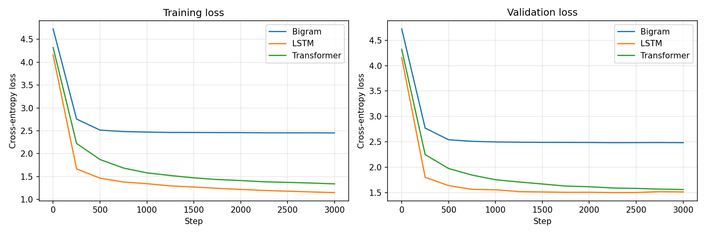
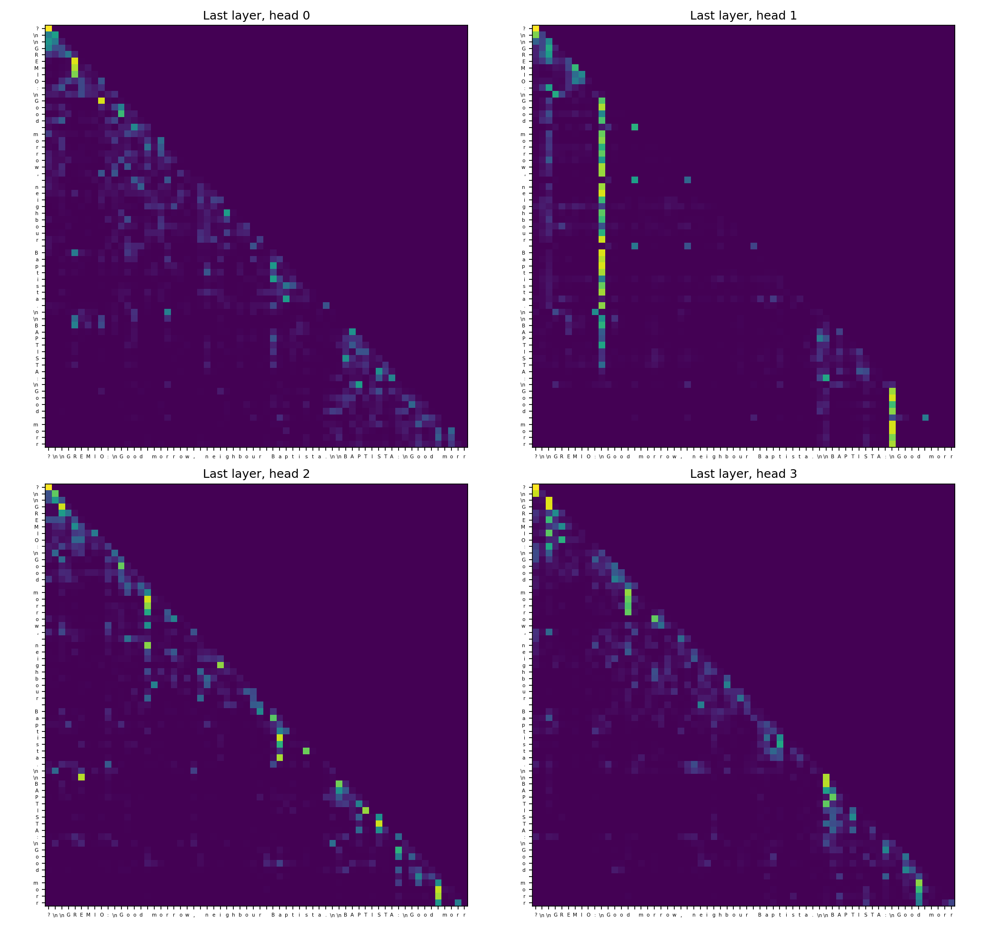

# Comparing Bigram, LSTM, and Transformer Language Models

A comparison of three model architectures on the same task, **character-level next-character prediction** on Tiny Shakespeare, to understand how each one processes language and what attention adds.

All code and analysis is in [`midterm_project.ipynb`](midterm_project.ipynb).

## Repository Contents

| File | Description |
|---|---|
| `midterm_project.ipynb` | All code, training runs, explanations, and analysis |
| `data/input.txt` | Tiny Shakespeare dataset |
| `results.md` | Results table comparing the three models |
| `samples.md` | Generated text samples from each model |
| `loss_curves.png` | Training and validation loss for all three models |
| `attention_heatmap.png` | Attention weights for one head of the 3000-step Transformer |
| `attention_all_heads.png` | Attention weights for all 4 heads in the last layer (6000-step Transformer) |
| `experiment_6000_steps.png` | Validation loss for the longer-training experiment |
| `ai_use_summary.md` | How AI was used in this project |
| `requirements.txt` | Python dependencies |

## How to Run

```bash
python3 -m venv .venv
source .venv/bin/activate
pip install -r requirements.txt
jupyter notebook midterm_project.ipynb
```

The dataset is included in `data/input.txt`. If it's missing, the notebook downloads it automatically, or you can get it with:

```bash
mkdir -p data
curl -o data/input.txt https://raw.githubusercontent.com/karpathy/char-rnn/master/data/tinyshakespeare/input.txt
```

Runs on CPU, Apple Silicon (MPS), or CUDA. On a MacBook Air (MPS), the full notebook takes about 25 minutes, including the 6000-step experiment.

## 1. What NLP task did I solve?

**Next-character prediction:** given the previous characters, predict the next one. Each model outputs a probability distribution over the 65 possible characters. Models are trained with cross-entropy loss, then used to generate new text one character at a time.

## 2. What dataset did I use?

**Tiny Shakespeare**: about 1.1 million characters from Shakespeare's plays, with 65 unique characters. The first 90% of the text is used for training and the last 10% for validation.

## 3. What three models did I compare?

| Model | Parameters | Context used |
|---|---|---|
| Bigram | 4,225 | Current character only |
| LSTM (2 layers, 256 hidden units) | 946,625 | Up to 128 previous characters, through a hidden state |
| Transformer (4 layers, 4 heads, 128-dim) | 824,897 | Up to 128 previous characters, through self-attention |

To keep the comparison fair, all three use the same data split, context length (128), batch size (64), number of steps (3000), optimizer (AdamW), and evaluation procedure. The LSTM and Transformer have similar parameter counts. Learning rates differ (1e-2, 2e-3, 1e-3), because each architecture trains stably at a different rate.

## 4. How does each model work?

**Bigram.** A 65 × 65 lookup table: row *i* holds scores for which character follows character *i*. It uses only the current character and ignores everything before it. It can learn common letter pairs, but it can't form words or track context. After "e", it gives the same prediction whether it's in "the", "be", or "Romeo".

**LSTM.** Reads the text one character at a time, updating a hidden state that summarizes everything it has seen so far. Its gates decide what to keep, forget, and add at each step. This gives it far more context than the bigram, but all of that history must be compressed into one fixed-size vector passed forward step by step, so information from far back tends to fade.

**Transformer.** Each character gets a token embedding plus a positional embedding (attention has no built-in sense of order). In each of 4 blocks, **causal self-attention** lets every position look directly at every earlier position: queries and keys decide how much weight to give each earlier character, and values carry the information. A causal mask blocks attention to future characters. A feedforward layer then processes each position, and residual connections plus layer normalization keep training stable. A final linear layer outputs scores for the 65 characters.

## 5. Which model performed best?

### Results (3000 steps each)

| Model | Train Loss | Val Loss | Val Perplexity | Training Time | Text Quality | Notes |
|---|---|---|---|---|---|---|
| Bigram | 2.455 | 2.483 | 11.97 | 14s | Low | Letter pairs but almost no real words |
| LSTM | 1.151 | **1.513** | **4.54** | 157s | Medium–High | Best val loss; started overfitting after step 2250 |
| Transformer | 1.341 | 1.560 | 4.76 | 376s | Medium–High | Still improving at step 3000; smaller train/val gap |

### Extra experiment: Transformer trained for 6000 steps

| Model | Steps | Final Val Loss | Best Val Loss | Training Time |
|---|---|---|---|---|
| LSTM | 3000 | 1.513 | 1.4995 | 157s |
| Transformer | 6000 | 1.514 | 1.513 | 875s |



**Best model: the LSTM**, by a small margin. At 3000 steps it had the lowest validation loss. Because the Transformer was still improving, I trained it for 6000 steps. It then matched the LSTM's final loss (1.514 vs 1.513), but it didn't beat the LSTM's best checkpoint and needed 5.6× the training time. Both models leveled off around 1.50–1.51, which suggests the limit is the small dataset rather than the architecture.

**Fastest to train:** the bigram (14s), then the LSTM (157s), then the Transformer (376s). Times vary 10–20% between runs on a laptop, but the ranking stayed the same.

**Most realistic text:** the LSTM and Transformer are close. Both produce mostly real words, real Shakespeare character names, correct speaker formatting, and verse-length lines, but they still invent words and don't carry meaning across sentences. The bigram only produces the visual shape of a play with made-up words. See [`samples.md`](samples.md) for full samples. Short excerpts:

> **Bigram:** `Whee amish mene be e llpueangbucyoy, armact teatenthaixt frel amanl;`
>
> **LSTM:** `Look, madam, it thus, good Mercutio, / The nature dischess hath he respair`
>
> **Transformer:** `MERCUTIO: / What you are deable to gain! O my sovereign,`

## 6. What did attention improve?

Compared with the **bigram**, attention (along with the rest of the Transformer) gave a huge improvement: perplexity fell from about 12 to about 4.5, and the output went from letter soup to real words, names, and verse.

Compared with the **LSTM**, the improvement on this task was small to none. Measuring how far back each attention head looks explains why:

| | head 0 | head 1 | head 2 | head 3 |
|---|---|---|---|---|
| layer 0 | 2.6 | 3.1 | 12.6 | 3.6 |
| layer 1 | 2.2 | 3.8 | 3.0 | 4.1 |
| layer 2 | 4.1 | 5.9 | 4.2 | 5.2 |
| layer 3 | 11.5 | 14.4 | 9.1 | 7.8 |

*(average number of characters back each head attends)*

Early layers focus on the last 2–6 characters, which is enough for spelling. The last layer looks 8–14 characters back, which spans about two or three words. Different heads specialize: one head in layer 0 already looks about 12 characters back while the others stay local. But nearly all attention falls within about 15 characters, a range an LSTM's hidden state can also handle. The Transformer's key strength, reaching 100+ characters back in a single step, barely gets used on short-range character prediction.



**Was the improvement worth the added complexity?** For this project, no. On 1 million characters with a 128-character context, a similar-sized LSTM reached the same or better loss in a fraction of the time. Attention pays off with larger datasets, longer contexts, and bigger models, where long-range dependencies matter more and the Transformer's ability to process all positions in parallel makes it faster to scale.

## 7. What did I learn from this project?

- **Context is the biggest factor.** The jump from 1 character of context (bigram) to 128 characters (LSTM or Transformer) mattered far more than the choice between the LSTM and Transformer.
- **"Transformers are better" depends on scale.** At this size, a well-sized LSTM tied the Transformer and trained much faster. I wouldn't have seen this without running the longer experiment.
- **Validation curves tell you more than final numbers.** The LSTM's final loss looked like a clear win at 3000 steps, but the curves showed that it had stopped improving while the Transformer hadn't. That's what led to the 6000-step experiment.
- **Attention is learned and structured.** The heads aren't random. They develop a pattern: local in early layers, longer-range in the last layer, with individual heads specializing.

## 8. How did I use AI responsibly?

I used Claude (Anthropic) throughout the project, and the details are in [`ai_use_summary.md`](ai_use_summary.md). In short, Claude wrote the code, the explanations, and the analysis. I set up the environment, ran all training and experiments, debugged setup and disk-space problems, and reviewed the results. All numbers in this README come from my own training runs.

## Final Reflection

**After comparing bigram, non-transformer, and transformer models, what makes transformers powerful for language modeling?**

Transformers are powerful because attention gives every position **direct, selective access to all earlier context**. An LSTM must pass information forward one step at a time through a fixed-size memory, so older details fade. A Transformer can look back at exactly the characters it needs, at any distance, in a single step, and it learns where to look. My attention measurements showed this happening in a structured way: early layers handle local spelling, the last layer combines information across words, and different heads specialize in different distances.

This project also showed me that this power is about **potential at scale**, not an automatic win. On my small dataset, the LSTM matched the Transformer because the useful context was mostly within about 15 characters. The Transformer's real advantages are that it doesn't have a memory bottleneck for long-range dependencies, and that it processes all positions in parallel during training. Both become decisive as models, datasets, and context lengths grow. That's why Transformers dominate large language models, even though a small LSTM held its own here.